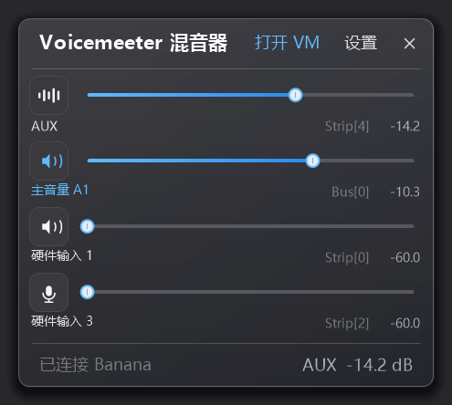
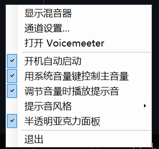
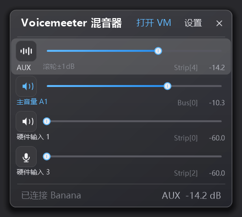
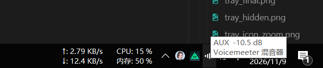
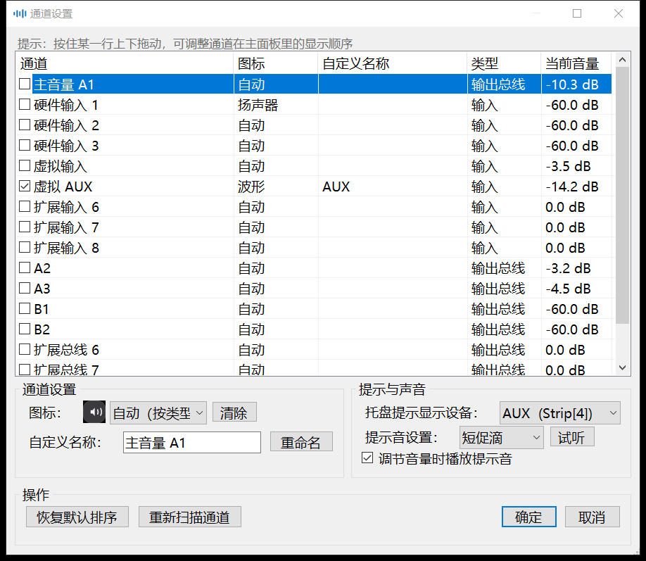

# Voicemeeter 混音器 (VMixer)

给 **Voicemeeter Banana / Pro / Potato** 用的 Windows 托盘混音面板，
效果类似 Win10 / Win11 自带的「音量合成器」浮出卡片，但调节的是 **Voicemeeter 自己的通道音量**。

Voicemeeter 装好后，拖 Windows 的音量条是调不动它那些通道的音量，以及虚拟的合成总声道音量。——这个小工具就是补上这一块。

> **下载**：到 [Releases 页面](https://github.com/weirui777/voicemeeter-mixer/releases) 下载 `VMixer.zip`，
> 解压双击 `VMixer.exe` 就能用。**免安装**，不需要管理员权限，不联网。
> 完整步骤见下面的[安装与使用](#安装与使用)。

## 功能

- **托盘常驻**：单击托盘图标弹出面板，失焦自动隐藏，和 Win10 的音量合成器一致
- **Win11 风格界面**：圆角卡片 + 毛玻璃，界面全部自绘，自动跟随系统深浅色主题
- **通道自动识别**：不用手填，数量、名称、当前音量都按 Voicemeeter 的实际状态读出来
- **通道可自定义**：勾选要显示哪些通道、改名、换图标，还能**拖动调整显示顺序**
- **调音量**：拖滑条、悬停滚轮（±1 dB）、双击回 0 dB、点图标磁贴静音
- **调节提示音**：调音量时「叮」一声，4 种音色可切换，程序现场合成，不依赖任何音频文件
- **接管系统音量键**（可选）、`Ctrl + Alt + V` 呼出面板、可选开机自启
- **单实例运行**，重复启动只会把已有的面板唤出来

## 安装与使用

### 系统要求

| 项目 | 要求 |
| --- | --- |
| 操作系统 | Windows 10 / 11（x64） |
| 运行时 | .NET Framework 4.x —— **Win10/11 自带，不用另外装** |
| 前提软件 | 已安装并且**正在运行**的 Voicemeeter（Banana / Pro / Potato 任意版本） |

### 安装步骤

1. 在 [Releases 页面](https://github.com/weirui777/voicemeeter-mixer/releases) 下载 `VMixer.zip`。
2. 解压到任意目录，例如 `D:\Tools\VMixer\`。
   解压出来是 `VMixer.exe`、`vmixer.ico`、本说明和几张界面截图——
   **`VMixer.exe` 就是全部，别的文件都可以删**（`vmixer.ico` 只是留个资源）。
3. 双击 `VMixer.exe`。
   - 第一次运行 Windows 可能弹「Windows 已保护你的电脑」，
     因为这个程序**没有做代码签名** → 点「**更多信息**」→「**仍要运行**」。
   - **不需要「以管理员身份运行」**。
4. 任务栏右下角出现一个**波形图标**（右下带小 v）就算装好了。
   - 点它左键 → 弹出混音面板；点它右键 → 菜单。
   - 图标可能被 Windows 折叠进右下角的 `^` 里，往上翻一下。

### 首次使用

1. **先把 Voicemeeter 启动起来**。程序靠 Remote API 连运行中的 Voicemeeter，
   没启动就看不到通道（底部状态栏会显示「已连接 xxx · 未运行」，每秒自动重试，一起来就自动接上）。
2. 默认显示「主音量 A1」+ 硬件输入 1/2/3 + 虚拟输入 + 虚拟 AUX。
   想换通道 → 点面板右上角「**设置**」勾选。
3. 想自己排顺序 → 在设置窗口的列表里**按住某一行上下拖动**，松手即换位；
   排好点「确定」，主面板就按这个顺序显示。
4. 建议把 exe 放在一个**固定目录**再勾「开机自动启动」——
   目录变了程序会自动把注册表里的路径改回来，不会变成开机启动失败。

### 日常操作速查

| 操作 | 效果 |
| --- | --- |
| 单击托盘图标 | 弹出 / 隐藏混音面板（面板失焦会自动隐藏，和 Win10 一样） |
| 左右拖动滑条 | 调这条通道的音量（越往右越响，左端 −60 dB，右端 +12 dB） |
| 悬停某条通道后滚轮 | 那条通道 ±1 dB（不用先点一下） |
| 双击滑条 | 回到 0 dB |
| 点击行首图标磁贴 | 静音 / 取消静音 |
| 右键通道名 | 重命名 / 静音 / 通道设置 |
| `Ctrl + Alt + V` | 呼出 / 隐藏面板 |
| 托盘右键 | 提示音风格、开机自启、系统音量键接管、半透明面板、退出 |

### 卸载

1. 托盘右键 →「**退出**」。
2. 删掉解压出来的整个文件夹。
3. 删掉配置目录 `%APPDATA%\VMixer`（通道选择、排序、图标等设置都在里面）。
4. 如果之前勾过「开机自动启动」，在托盘菜单里取消勾选即可；
   也可以手动删除注册表 `HKCU\Software\Microsoft\Windows\CurrentVersion\Run` 下的 `VMixer` 值。

### 常见问题

| 现象 | 原因 / 解决办法 |
| --- | --- |
| 双击后什么都没出来 | 这是**托盘常驻**程序，窗口不在任务栏而在右下角托盘（可能被 `^` 折叠了）。托盘里也找不到 → 看 `%APPDATA%\VMixer\error.log` |
| 底部显示「已连接 Banana · 未运行」 | Voicemeeter 没在运行，先把它开起来，程序每秒自动重试 |
| 「通道设置」打不开、列表空的 | 同上，Voicemeeter 得先运行；起来后点「重新扫描通道」 |
| Windows 说「已阻止此应用」 | 没做代码签名，点「更多信息」→「仍要运行」 |
| 改了音量，Voicemeeter 里看着没反应 | 可能别的程序也连了 Remote API 并执行了 Logout，**先把 VMixer 退出**再操作 |
| 提示音从 Voicemeeter 的输出里出来 | 提示音走系统默认播放设备，默认设备被 Voicemeeter 接管时就会这样 |
| 面板深浅色和系统不一致 | 跟随系统主题（`AppsUseLightTheme`），下次弹出即生效 |
| 想看程序到底改了什么 | 审计日志 `%APPDATA%\VMixer\vm.log`，每次写入都有一行 `SET Bus[0].Gain = -8.80` |

## 两点说明

- **面板上没有实时电平条**：Voicemeeter 的电平接口会把电平值写回增益槽位，
  配合本程序的参数泵会污染你的音量设置——与其冒险，不如少这个功能。详见[开发文档](https://github.com/weirui777/voicemeeter-mixer/blob/main/DEVELOPMENT.md)。
- **本程序运行期间，其他连 Voicemeeter Remote API 的脚本可能登录不上**，
  需要用脚本改参数时先把 VMixer 退出。

## 开发

源码、编译方式、命令行参数和踩坑记录都在 [DEVELOPMENT.md](https://github.com/weirui777/voicemeeter-mixer/blob/main/DEVELOPMENT.md)。
