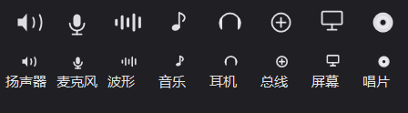

# Voicemeeter 混音器 (VMixer)

一个给 **Voicemeeter Banana / Pro / Potato** 用的 Windows 托盘混音面板，
效果类似 Win10 / Win11 自带的「音量合成器」浮出卡片，但调节的是 **Voicemeeter 自己的通道音量**
（不是系统音量）。Voicemeeter 装好后拖 Windows 音量条是没用的，这个小工具就是补上这一块。


## 界面

整体照着 **Win10 音量合成器** 来做：通道**竖排一列**，一行一个通道。

- **Win11 风格深色浮出卡片**：圆角卡片、柔和投影、背后画面实时模糊的毛玻璃（亚克力）质感，
  全部内容自绘，没有任何边框和子控件。
- **跟随系统深浅色**：自动读取注册表 `HKCU\...\Themes\Personalize\AppsUseLightTheme`，
  Windows 处于深色模式就是深色卡片，浅色模式就是浅色卡片，切换系统主题后面板下次弹出即生效。
- **竖排一列的通道列表**（每一行 = 一条通道，自上而下）：
  1. **一行的左边是图标磁贴**（麦克风 / 波形 / 扬声器），**右边紧跟着横向滑动条**，两者同一行：
     细横条 + 小圆钮，蓝色是当前增益，**越往右越响**（左端 −60 dB，右端 +12 dB）；
     **点击图标块 = 静音 / 取消静音**（静音时图标块变红并带红色斜杠徽标）；
  2. **磁贴下方一行三栏文字**：左边是通道名（主音量 A1 / 硬件输入 1 / 虚拟输入 / 虚拟 AUX，
     可右键重命名），中间偏右是它在 Voicemeeter 里对应的对象（`Bus[0]` / `Strip[3]` …），
     最右边是当前 dB 数值。
- **数值显示**：直接显示 Voicemeeter 里的真实 dB（例如 `-2.1`、`-60.0`），和写入日志、`--test` 输出完全一致。
- **底部状态栏**：左边是连接状态（例如「已连接 Banana」），
  **右边显示的就是托盘气泡里那一模一样的信息**（你指定那条通道的「名称 + 当前 dB」），
  两处共用同一个数据源，永远不会对不上。
- **悬停提示**：鼠标悬浮到某条通道上时，**通道名后面会跟一句「滚轮±1dB」**，
  灰色小字，字号和颜色都跟右边的对象名（`Strip[0]` / `Bus[0]`）一样，
  提示只出现在所在通道自己的行里，**不会和底部状态栏的内容叠在一起**。


- **头部**：左边标题，右边依次是「打开 VM」（拉起 Voicemeeter 主界面）、「设置」、关闭 ✕。
- **托盘气泡（鼠标悬浮角标）**：鼠标停在托盘图标上，Windows 会弹出气泡提示框，
  里面显示你指定那条通道的实时数值（例如「AUX  -10.5 dB」）；
  没指定通道时显示主音量。


- **通道图标可自定义**：通道设置里能给每条通道单独指定图标——
  8 种内置字形（扬声器 / 麦克风 / 波形 / 音乐 / 耳机 / 总线 / 屏幕 / 唱片）。
  「图标：」后面直接显示**当前选中通道的图标预览**，改图标立刻能看见效果；
  旁边的输入框是「自定义名称：」，改完点「重命名」生效。


- **托盘图标**：**波形图标**（4 根高低错落的圆头竖条），**右下角带一个小 v**（代表 Voicemeeter 的 Voice），
  配色随任务栏深浅色自动切换：深色任务栏用白色，浅色任务栏用深灰。
  同一个图标按 16/20/24/32/48/64 六档分别绘制，任务栏按自己的 DPI 取最合适的那一档，不靠缩放。


- **exe 图标**：任务栏 / 资源管理器里显示的也是同一个波形图标（蓝色强调色）。

## 功能

- **托盘常驻**：任务栏右下角出现波形图标，左键单击弹出面板，右键是菜单。
- **主音量 + 多声道**：默认显示「主音量 A1」以及硬件输入 1/2/3、虚拟输入、虚拟 AUX。
- **通道是自动扫描出来的，不用手填**：
  - 程序启动时自动找 Voicemeeter 的远程接口 DLL（依次找
    `%ProgramFiles(x86)%\VB\Voicemeeter\` → `%ProgramFiles%\VB\Voicemeeter\` → exe 同目录，
    也可以在 `config.ini` 里写 `DllPath=` 指定）；
  - 连上后逐个探测 `Strip[0..n].Gain` / `Bus[0..n].Gain` 是否存在，
    **通道数量、名字、当前音量全部按 Voicemeeter 的实际状态读出来**；
  - **换一台新机器：先装好 Voicemeeter，再装这个面板，直接用，不需要任何手动配置**；
  - 前提是 **Voicemeeter 必须在运行**（Remote API 连的是运行中的程序）。
    没运行时会弹一次气泡提示，之后每秒自动重试，Voicemeeter 一起来就自动接上；
  - 在 Voicemeeter 里新增了 strip / bus 之后，在通道设置里点「重新扫描通道」即可刷新列表。
- **通道可自选**：点面板右上角「设置」，可勾选要显示的通道（输入条 / 输出总线共 16 个）、
  给通道改名、绑定图标，并指定哪条通道显示在托盘气泡里，设置会记住。


- **通道设置窗口分三块**，位置固定，窗口拉大拉小都会跟着重排：
  - **通道设置**（左上）：图标下拉 + **图标预览** + 清除、自定义名称 + 重命名；
  - **提示与声音**（右上）：托盘气泡显示哪条通道、提示音音色、试听、是否播放提示音；
  - **操作**（下方一整条）：恢复默认排序 / 重新扫描通道 / 确定 / 取消。
- **拖动排序**：在通道设置窗口的列表里**按住某一行上下拖动**就能改顺序，
  拖动时列表上有一条蓝色插入线，松手即换位；
  - 列表正上方有一行灰色小字提示「按住某一行上下拖动，可调整通道在主面板里的显示顺序」；
  - 勾选框那一小块不参与拖动（点勾选框不会误触发排序）；
  - 排好序点「确定」，**主面板会严格按这个顺序显示通道**；
  - 点「恢复默认排序」恢复成「主音量 → 输入条 → 输出总线」的自然顺序；
  - 顺序保存在 `config.ini` 的 `[Order]` 段，下次打开还在。
- **鼠标操作**：
  - 拖动横向滑条改音量（也可直接点滑条跳到该位置）
  - **鼠标悬浮到某条通道上，直接滚滚轮就能调那条通道的音量（±1 dB）**，不需要先点一下
  - 滚轮在面板之外滚动时，会把滚轮**转交回**你原来在用的那个窗口，不会把你的编辑器滚动吃掉
  - 双击滑条回到 0 dB
  - 点击行首的图标磁贴切换静音
  - 右键通道 → 重命名 / 静音 / 通道设置
- **调节音量时的提示音**（像 Win10 那样「叮」一声）：
  - 点击 / 拖动滑条 → **立刻响**，音量按你正在调的那条通道的增益缩放（调得越小越轻）；
  - 滚轮调节 → **停下来之后响一声**（滚动过程中不响，避免变成机关枪）；
  - 音色是**干净的金属「叮」**：基频 + 2 / 2.76 / 4.07 / 5.43 倍的铃铛分音，高次分音衰减更快，
    不是两三个正弦硬叠（那样会互相拍频，听着像刺耳的蜂鸣）；
  - **四种音色可随时切换**：托盘右键 →「提示音风格」→ 清脆叮（默认）/ 明亮叮 / 柔和钟 / 短促滴，
    选中会立刻试听一声；也可以在**通道设置窗口**里用「提示音设置：」下拉框选，
    旁边的「试听」按钮可以先听再定，切换结果记在 `config.ini` 里；
  - 提示音是程序自己用 Windows 波形接口实时合成的，
    **不依赖任何音频文件、音频库，也不联网**，走系统默认播放设备；
  - 托盘菜单里可以随时关掉（「调节音量时播放提示音」），
    通道设置窗口底部也有对应的「调节音量时播放提示音」勾选框，两处状态同步。
- **系统音量键接管**（可选，默认开）：键盘上的音量 +/−、静音键控制 Voicemeeter 主音量，而不再改变 Windows 系统音量。
- **快捷键**：`Ctrl + Alt + V` 呼出/隐藏面板。
- **开机自启**：托盘菜单里勾选即可（写入 HKCU Run，无需管理员）；勾选后程序每次启动还会自动补写一次注册表，换了目录也能自愈。
- **单实例运行**，重复启动 exe 只会把已有实例的面板唤出来。
- 托盘菜单里的 **「半透明亚克力面板」** 可关掉毛玻璃，换成普通不透明面板。

## 使用

1. 先启动 Voicemeeter（Banana / Pro / Potato 均可，本机装的是 Voicemeeter Banana x64）。
2. 双击 `VMixer.exe`。右下角出现波形图标，左键点击弹出面板。
3. 面板失焦会自动隐藏，和 Win10 的行为一致。

命令行参数：

| 参数 | 作用 |
| --- | --- |
| `VMixer.exe` | 正常启动（托盘常驻） |
| `VMixer.exe --show` | 启动即弹出面板 |
| `VMixer.exe --test` | 自检：打印通道列表，并对主音量做一次写入/回读测试后自动还原 |
| `VMixer.exe --layout` | 导出面板各通道滑块的屏幕坐标到 `%APPDATA%\VMixer\layout.txt`（排查/自动化用） |
| `VMixer.exe --icon [路径]` | 把托盘图标导出成 PNG（默认写到 `%APPDATA%\VMixer\icon.png`），用于预览/做图标资源；路径以 `.ico` 结尾则导出多尺寸 ico |
| `VMixer.exe --render [路径]` | 把面板离屏渲染成 PNG（不依赖屏幕），用于排查界面问题 |
| `VMixer.exe --tone [音色] [dB]` | 提示音自检：打印波形设备能否打开，并按指定音色/dB 播一次提示音（音色：0-3 或 clear/bright/soft/blip，默认清脆叮 0 dB） |
| `VMixer.exe --towav [路径] [音色]` | 把指定音色的提示音导出成 WAV（默认 `%APPDATA%\VMixer\tone.wav`），用来客观比对波形 |
| `VMixer.exe --settings` | 单独打开「通道设置」窗口（调试 / 不经过托盘直接改设置用） |
| `VMixer.exe --dragtest` | 拖动排序自测：模拟两次拖动并把结果写进 `config.ini` 的 `[Order]`（会改动顺序，仅用于验证） |
| `VMixer.exe --glyphs [路径]` | 把 8 个内置图标字形画成一张对照图（默认 `%APPDATA%\VMixer\glyphs.png`），用于检查图标 |

配置文件：`%APPDATA%\VMixer\config.ini`
（`[General] SoundFeedback=1` 就是「调节音量时播放提示音」的开关，
`[General] ToneStyle=0` 是提示音音色（0 清脆叮 / 1 明亮叮 / 2 柔和钟 / 3 短促滴）；
`[General] TipChannel=S4` 指定**托盘气泡**里显示哪条通道，留空 = 不显示；
`[Channels] Visible=` 是要显示的通道，留空表示默认 6 条；
`[Order] Order=` 是通道显示顺序（通道设置窗口里**拖动排序**后的结果），留空表示默认顺序；
`[Order] OrderCustom=1` 表示这个顺序是用户自己拖出来的（程序据此区分「你排的」和「机器排的」）；
`[Icons]` 段是每条通道的图标设置，值形如 `S4=b:disc`（内置字形））

写入审计日志：`%APPDATA%\VMixer\vm.log`（只记录本程序对 Voicemeeter 的写入，方便对账）

## 通道对应关系

Voicemeeter 的 Remote API（`VoicemeeterRemote64.dll`）用字符串参数名寻址，
本工具自动探测当前 Voicemeeter 里实际存在的通道，映射如下（Banana / Pro 布局）：

| 面板名称 | API 参数 | 说明 |
| --- | --- | --- |
| 硬件输入 1 / 2 / 3 | `Strip[0].Gain` ~ `Strip[2].Gain` | 声卡输入（麦克风等） |
| 虚拟输入 | `Strip[3].Gain` | Voicemeeter Input（放应用的虚拟输入） |
| 虚拟 AUX | `Strip[4].Gain` | Voicemeeter AUX |
| 主音量 A1 | `Bus[0].Gain` | 主输出总线，对应 Voicemeeter 里的 HARDWARE OUT A1 |
| A2 / A3 | `Bus[1]` / `Bus[2]` | 第二、三路物理输出 |
| B1 / B2 | `Bus[3]` / `Bus[4]` | 虚拟输出总线 |

> 你的 Voicemeeter 版本里界面上的 MASTER SECTION 只有 A1/A2/A3/B1/B2 五个总线，
> **没有独立的 MASTER 推子**，Voicemeeter 主输出就是 A1，所以本工具把 A1 标成「主音量」。

## 实现要点（踩坑记录）

- **必须调用 `VBVMR_IsParametersDirty()`**：官方 SDK 文档写明这个函数会「让 Voicemeeter 处理客户端推送过去的参数」。
  只写不调用它，写入的参数会一直挂着不生效（实测能挂十几秒甚至更久）。
  本工具在后台线程里每 10 ms 调一次，写入到实际生效约 30 ms。
  （自己写脚本改参数时也一样：写完要泵一会儿 `VBVMR_IsParametersDirty()` 再读，否则读到的还是旧值。）
- **所有 API 调用都在同一条线程**：Remote API 不是完全线程安全的，因此读取、写入统一放在后台线程，UI 只读缓存。
- **通道索引是探测出来的**，不是写死的：不同版本（Banana / Potato）条数不同，程序启动时逐个探测 `Strip[i].Gain` /
  `Bus[i].Gain` 是否存在；参数名大小写敏感，必须写 `.Gain` / `.Mute`。
- **亚克力效果是自己做的**（没走 DWM 模糊）：面板是 `WS_EX_LAYERED` 分层窗口，内容画在 32 位 ARGB 位图上，
  再用 `UpdateLayeredWindow` 贴到桌面，所以才能同时做到圆角 + 每像素透明 + 柔和投影。
  毛玻璃的做法是：显示前把自己藏起来 → 抓取将要显示区域的屏幕画面 → 两级降采样模糊 → 作为卡片底图贴上去 →
  再叠一层白色蒙版。刷新时重新抓一次背景即可。
- **没有背景时的兜底卡片也要跟主题**：抓不到背景（不透明模式 / 离屏渲染）时曾经硬编码画浅色卡片，
  结果深色主题下变成「浅底白字」完全看不清。现在兜底分支也按深/浅色分别取色。
- **透明层上不能用 ClearType**：`TextRenderer`（GDI）在带 alpha 的位图上会渲染出红蓝描边，
  面板文字统一改用 `Graphics.DrawString` + `AntiAliasGridFit`。
- **Remote API 是共享会话**：如果别的程序也调用了 Remote API 并执行了 `VBVMR_Logout()`，
  本进程读回来的参数会停在旧值上（写入其实生效了，但显示会慢一拍）。
  程序每次写入后都会回读校验，发现不一致就自动重建会话（重新加载 DLL 并登录）并重发，从而恢复同步。
  同理，**本程序运行期间别的进程可能登录不上 Remote API**（登录返回非 0），
  这时用脚本读写参数会全部返回 `ERR`——需要先把 VMixer 退出再操作。
- **⚠️ `VBVMR_GetLevel()` 有破坏性副作用，已彻底弃用**：这个「读取电平」的接口会把电平数值
  写进共享内存里对应的**增益槽位**（例如主总线电平 2.092 会出现在 `Bus[0].Gain`，
  AUX 电平 -22.298 会出现在 `Strip[4].Gain`）。因为本工具每 10 ms 泵一次参数，
  这些电平值会被当成音量提交给 Voicemeeter，**直接把用户的音量设置改坏**。
  因此本工具完全不调用 `VBVMR_GetLevel()`，面板上也就**没有实时电平条**——
  这是刻意舍弃的功能，保留它就等于随时会篡改你的音量。
- **后台唤出面板要抢前台焦点**：Windows 的前台锁会让后台程序调 `SetForegroundWindow` 失效，
  于是「失焦自动隐藏」会在 0.6 秒后把刚弹出的面板收掉。
  程序现在用 `AttachThreadInput` 临时接入前台线程再设置焦点，保证弹出后能稳定停留并接收点击。
- **重复启动通过命名事件通知**：第二个实例不新建窗口，而是 `Set()` 一个
  `Global\VMixer_ShowPanel` 事件；主实例在后台线程 `WaitOne` 到信号后，
  通过 UI 定时器在 UI 线程执行弹面板，避免跨线程碰窗口。
- **`StringFormatFlags.LineLimit` 会把「装不下」的一行整行丢掉**（不是裁剪）。
  面板按 125% 缩放后，8.5pt 中文字体的行高约 24.7 px，
  原来的通道名那行只有 22 px 高，于是**文字被整个丢弃，界面上一个字都看不到**。
  现在那行加高到 28 px，并且在 `DrawTextEllipsis` 里加了兜底：
  量出来放不下就临时缩小字号重画，保证任何情况下文字都可见。
- **滚轮事件的坐标不能直接用**：`WM_MOUSEWHEEL` 的 lParam 在不同路径下
  会被解释成屏幕坐标或客户区坐标，WinForms 传出来的 `e.Location` 也不可靠。
  现在统一用 `Cursor.Position`（光标当前屏幕位置）换算，命中哪条通道就调哪条。
- **横向滑条的方向要和直觉一致**：滑条越往右越响（−60 dB → +12 dB）。
  绘制函数 `XFromValue` / `ValueFromPoint` 必须用同一套换算，否则旋钮和实际增益会反着来。
- **提示音自己合成**：用 `winmm` 的 `waveOut` 直接播一段 16 bit 单声道 PCM。
  音色用**铃铛分音模型**：基频 + 2 / 2.76 / 4.07 / 5.43 倍泛音，第 k 个分音的衰减常数按 `0.42^k` 递减
  （高次分音先死，金属味干净），3 ms 起音斜坡防爆音，末尾 30 ms 淡出，最后归一化到峰值 0.72。
  音量按 `10^(dB/20)` 线性缩放，≤ −60 dB 直接静音。
  播放放在线程池里，不阻塞界面；`WAVEHDR` 用 `Marshal.AllocHGlobal` 分配、
  播完 `waveOutReset` + `waveOutUnprepareHeader` + 释放。
  ⚠️ 一开始用「987.77 Hz + 1318.51 Hz 两个正弦叠加」当提示音，结果是个大三度，
  拍频出来的「呜」声非常难听——**提示音必须用单一基频的铃铛分音，不能靠多音叠加**。
- **设置窗口必须自己做 DPI 和布局**：本程序是 system-DPI 感知（`SetProcessDPIAware`），
  WinForms 不会再帮你缩放，`AutoScaleMode` 设成 `Dpi` 反而会二次放大，
  所以设置窗口改成 `AutoScaleMode.None` + 全部坐标走 `Ui.S()`；
  窗口改成可缩放 / 可最大化，列表铺满、底部操作区钉在下面，
  位置在 `LayoutControls()` 里统一算（窗口一变就重排）。
- **普通对话框里不能用 `Color.Transparent` 的子控件**：
  「控件不支持透明的背景色」会直接抛异常。用 `SystemColors.Control` 代替。
- **TopMost 的浮窗会挡住托盘气泡**：右下角浮窗本身是 TopMost，
  正好压在托盘图标正上方时，气泡弹出来会被它盖住。
  ⚠️ 该浮窗已按需求删除，现在只用 Windows 自带的托盘气泡，不再有遮挡问题。
- **写入审计日志**：每一次真正写进 Voicemeeter 的参数都会记到 `%APPDATA%\VMixer\vm.log`，  形如 `10:32:34.920  SET Bus[0].Gain = -8.80`；提示音也会记 `TONE db=...`，
  方便核对「什么时候响过、响的时候增益是多少」。
  以后再遇到「我的音量怎么变了」，直接看这个文件对账就能知道是不是本程序改的。
- **拖动阈值必须取绝对值**：判断「是不是在拖动」时写的是 `dx < 4 && dy < 4`，
  结果**向上拖的时候 `dy` 是负数，永远达不到阈值，一拖就断**——
  也就是「往下拖能排、往上拖排不了」。现在改成 `Math.Abs(dx) < 4 && Math.Abs(dy) < 4`。
  这个 bug 很隐蔽：向下拖是好的，只有向上拖才失效。
- **旧版本的「点列头排序」已经去掉**：WinForms 的 `ListView` 点了列头会自动排序，
  和用户想要的「自己拖出来的顺序」是两种东西，而且自动排序会把主音量甩到最后。
  现在排序完全由 `DragListView` 自己实现（按下 → 移动超过阈值 → 松手换位），
  列头不再响应点击。
- **旧配置里的顺序要能识别**：老版本保存的顺序是机器生成的「输入条全在前、输出总线全在后」，
  主音量会掉到末尾。程序加载时会把这种顺序识别出来丢掉（`OrderCustom` 标记区分），
  让主音量回到最前面；用户自己拖过的顺序则原样保留。

## 目录

```
VMixer/
├─ src/            C# 源码（.NET Framework 4.x，C# 5）
│  ├─ VmApi.cs         Remote API 封装、通道发现、参数泵线程、会话重建、写入审计
│  ├─ MixerPanel.cs    混音面板（全自绘：竖排布局、命中测试、拖拽、右键菜单、提示音接线）
│  ├─ LayeredSurface.cs 分层窗口基类（UpdateLayeredWindow、圆角、柔影、文字绘制）
│  ├─ ChannelControl.cs 图标磁贴 / 静音徽标 / 扁平按钮
│  ├─ FaderControl.cs  横向音量条的绘制与坐标换算（越往右越响）
│  ├─ SoundFx.cs       提示音：winmm waveOut 现场合成 + 按增益缩放
│  ├─ IconStore.cs     通道图标：8 种内置字形表
│  ├─ Dialogs.cs       通道设置对话框（三块分区 + 拖动排序 + 提示音选择）、重命名对话框
│  ├─ DragListView.cs  支持拖动排序的 ListView（按下→移动→松手，带插入指示线）
│  ├─ VmConfig.cs      配置持久化（INI）
│  ├─ Theme.cs         深/浅色配色（跟随系统 AppsUseLightTheme），含托盘图标配色
│  ├─ Glyphs.cs        波形图标绘制（托盘 / 标题栏 / exe 图标）
│  ├─ Ui.cs            DPI 缩放辅助
│  └─ Program.cs       托盘、热键、单实例、自检
├─ build.ps1      编译脚本（只出 dist\VMixer.exe）
├─ package.ps1    打包脚本（编译 + 生成 ico + 组装 release\ + 压 zip）
├─ docs/          README 里引用的界面截图
├─ tools/         研发 / 验证用脚本
│  ├─ *.ps1        界面抓图、点击自动化、自测（Windows 侧）
│  ├─ *.py        Voicemeeter Remote API 的探测 / 读写脚本
│  └─ *.rs        Rust FFI 绑定（研究 Remote API 用）
├─ dist/          编译产物（.gitignore 忽略）
└─ release/       发布包（.gitignore 忽略）
```

重新编译 / 打包：

```powershell
powershell -ExecutionPolicy Bypass -File .\build.ps1     # 只编译
powershell -ExecutionPolicy Bypass -File .\package.ps1   # 编译 + 出 release\VMixer.zip
```

依赖：.NET Framework 4.x（Win10 自带）+ 已安装的 Voicemeeter，无需管理员权限、无需联网。

## 已知限制

- 面板显示的数值来自 Voicemeeter 的实际状态，Voicemeeter 未运行时会提示「未检测到」并自动重试。
- 系统音量键接管需要注册全局热键，若被别的软件占用则不生效（不影响面板本身）。
- 毛玻璃背景是「显示瞬间」的截图快照，面板长时间停留时背景不会跟着桌面动画变化。
- 提示音走**系统默认播放设备**（如果默认设备被 Voicemeeter 接管，就会从 Voicemeeter 的输出里出来）。
- **面板不显示实时电平条**：Voicemeeter 的 `VBVMR_GetLevel()` 会把电平值写回增益槽位，
  配合本工具的参数泵会污染你的音量设置，因此宁可少这个功能也不用它（详见上文「实现要点」）。
